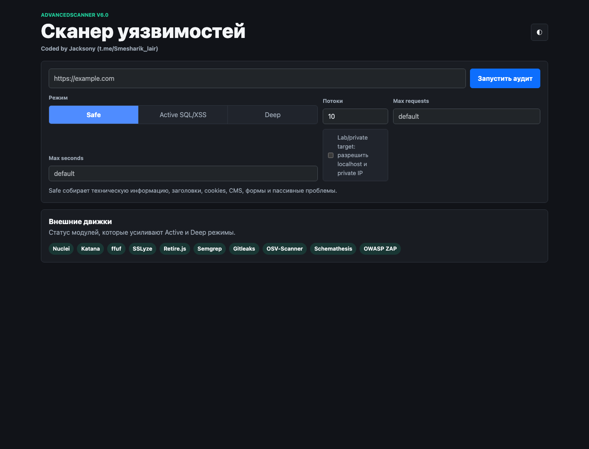
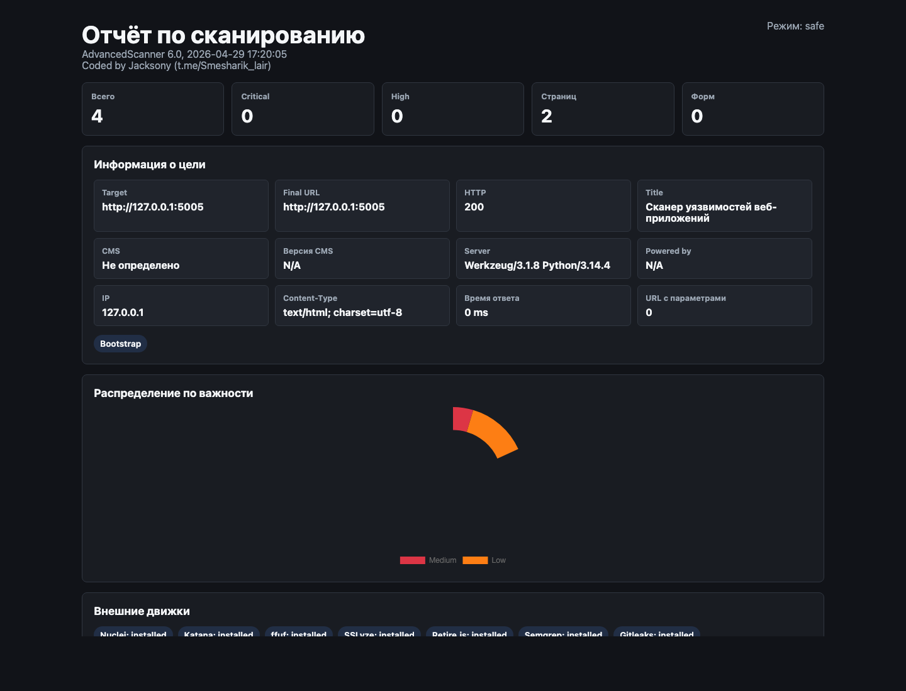

# AdvancedScanner

AdvancedScanner is a local, defensive web vulnerability scanner for authorized CTF, HackTheBox-like labs, PortSwigger labs, self-hosted targets, and bug bounty scopes where testing is explicitly permitted.

It is designed to map attack surface first, then run bounded passive/active checks with scope enforcement, request budgets, rate limits, timeouts, cancellation, and redacted evidence.

## Screenshots

### Web UI



### HTML Report



## Safety Rules

- Default mode is `safe`.
- Active and deep checks require explicit authorization.
- Targets must stay inside the configured scope hosts.
- Private/internal IPs, localhost, link-local, and metadata addresses are blocked by default.
- Enable private IP scanning only with `--allow-private-ips` or the UI lab/private checkbox for authorized local labs.
- No stealth/evasion, WAF bypass, CAPTCHA bypass, auth brute force, password spraying, credential stuffing, persistence, malware, shells, reverse shells, destructive exploitation, or data exfiltration.
- Payloads are safe validation probes: reflection markers, parser-error probes, arithmetic SSTI probes, boolean/time SQLi probes with strict budgets, and CRLF markers.

## Architecture

The scanner core is now discovery-first:

- `scanner/models.py`: `RequestTemplate`, `Finding`, `ScanConfig`, `ScanState`, `HttpResponseSnapshot`.
- `scanner/scope.py`: URL normalization, scope checks, private IP blocking, SSRF-style scheme rejection.
- `scanner/http_client.py`: one async request gateway with budgets, rate limiting, timeout, cancellation, scope enforcement, and redacted request logging.
- `scanner/registry.py`: request/finding dedupe and prioritization.
- `scanner/discovery/`: HTML/forms, JS endpoint extraction, sitemap, robots, OpenAPI, GraphQL signals, optional Playwright hook.
- `scanner/checks/`: modular checks with severity, confidence, evidence, remediation, source, tags.
- `scanner/scheduler.py`: passive-first then active/deep scheduling under budgets.
- `scanner/scanner.py`: thin orchestrator.
- `scanner/legacy_compat.py`: compatibility helpers for older tests/reporting while the new core is primary.

## Modes

- `safe`: discovery, passive headers, JWT/source-map/API-doc inventory, no active payload mutation.
- `active`: safe plus authorized low-risk validation probes for XSS reflection, SQLi, SSTI, CRLF, open redirect, CORS, GraphQL introspection, potential object references, and common exposures.
- `deep`: larger budgets and external discovery/checks; still no destructive payloads or automated exploitation.

## Discovery Sources

- Links, canonical/alternate links, iframes, meta refresh.
- Forms with method/action/enctype and hidden/select/checkbox/radio/textarea values.
- Same-scope JavaScript files with `fetch`, `axios`, `XMLHttpRequest`, `$.ajax`, and route-string extraction.
- `sitemap.xml`, `robots.txt`, `security.txt`.
- OpenAPI/Swagger candidates.
- GraphQL endpoint candidates.
- Optional external tools: Katana, ffuf, Nuclei, SSLyze, Retire.js.

## Checks

- Security headers and cookie posture.
- OpenAPI/Swagger exposed document inventory.
- Source map validation with real JSON shape checks.
- JWT passive detection without cracking.
- Reflected input and potential XSS context checks.
- SQLi error/boolean/time probes with safe budgets.
- SSTI arithmetic-only probes.
- Open redirect using parsed `Location` host comparison.
- CRLF marker detection.
- Common exposure rules with signatures, not plain `200 OK`.
- CORS origin reflection/wildcard checks.
- GraphQL endpoint, introspection, and verbose error checks.
- Potential IDOR/Object Reference only; it is not reported as confirmed IDOR without a second auth context.

## Web UI

```bash
python3 app.py
```

The UI binds to `127.0.0.1:5005` by default and prints a startup token for protected POST actions.

Use the lab/private checkbox only for local CTF/lab/self-hosted targets such as `127.0.0.1`, `10.x.x.x`, or `192.168.x.x`.

## CLI

```bash
python3 app.py https://example.com --mode safe
python3 app.py https://example.com --mode active --authorized
python3 app.py http://127.0.0.1:8080 --mode active --authorized --allow-private-ips
```

HTML reports are written to `reports/report.html`.

## External Tools

```bash
./scripts/install_engines.sh
```

External tools are optional and fail safe. Missing tools create warnings/status entries, not crashes. Nuclei is run with intrusive/dos/bruteforce templates excluded; Katana/ffuf discoveries are fed back into the request registry.

## Tests

```bash
PYTHONDONTWRITEBYTECODE=1 python3 -m unittest discover -s tests
python3 -m compileall -q app.py scanner tests
python3 -m pip check
```

## Limitations

- Authenticated multi-user authorization testing is not automatic yet; IDOR remains “Potential” without two configured auth contexts.
- Playwright capture is a safe stub until explicit browser capture flows are wired.
- The scanner does not bypass CAPTCHAs, login protections, WAFs, or rate limits.
- Findings are evidence-based hints for authorized validation; bug bounty reports should still include manual verification.

## Author

Coded by Jacksony (t.me/Smesharik_lair)
